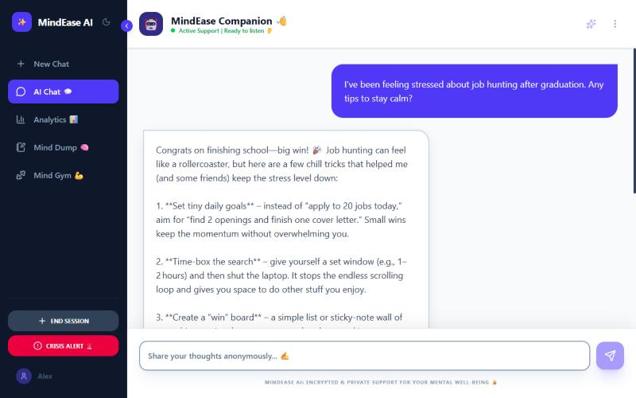
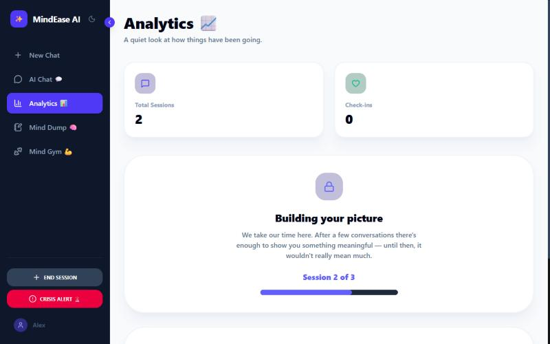
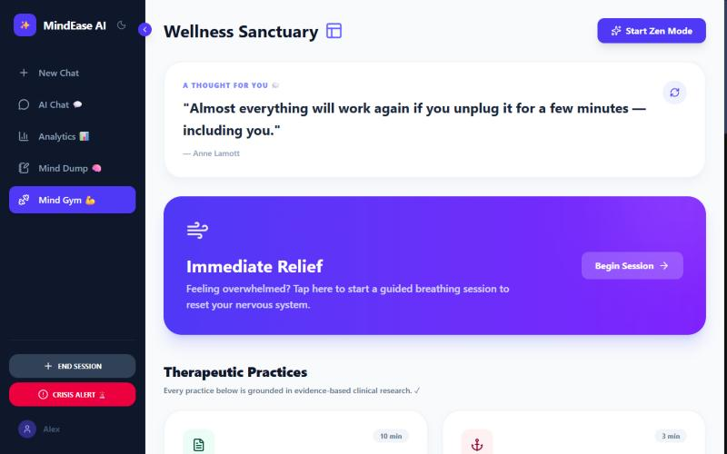
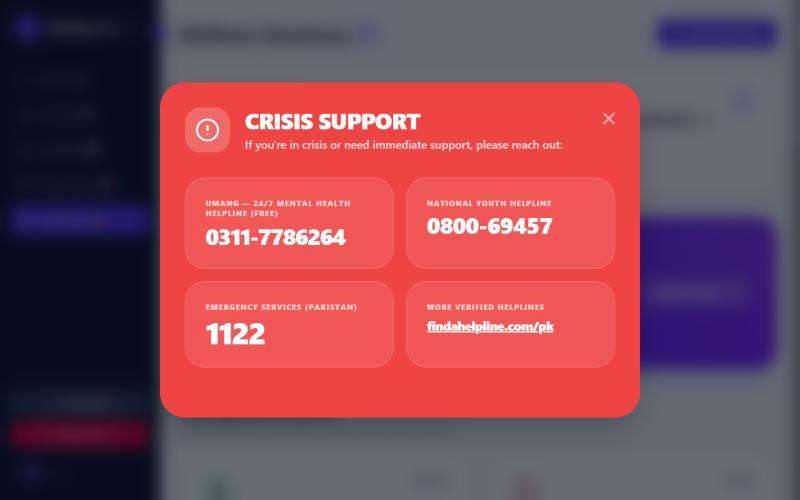

# MindEase AI

**An AI mental-wellness companion that answers from trusted mental-health guides, tracks mood over time, and detects crisis messages.**

MindEase is a full-stack app built on a **LangGraph agent** and **retrieval-augmented generation (RAG)**. Its answers are grounded in a library of mental-health self-help books instead of relying only on the model's general knowledge. Every message goes through a crisis-safety layer before a reply is shown.

> ⚠️ MindEase is a support tool, not a replacement for professional care. If you are in crisis, contact your local emergency number.

---

## Screenshots

| AI Chat | Analytics |
|---|---|
|  |  |

| Wellness Sanctuary | Crisis support |
|---|---|
|  |  |

---

## Features

- **Empathetic AI chat** that streams replies token by token (Server-Sent Events)
- **Grounded answers (RAG):** relevant passages are retrieved from mental-health guides and used in each response
- **Crisis detection:** a two-layer check (regex patterns + an LLM classifier) that shows emergency resources right away
- **Mood dashboard** with check-ins and trends over time
- **Journal** with AI-generated reflections
- **Wellbeing questionnaire** and a progress report
- **Resources page** with curated self-help material
- **Admin panel** and user feedback
- **Accounts** with bcrypt-hashed passwords and security-question recovery
- **Dark mode** and a responsive UI

## How it works

```
User message
    │
    ▼
┌──────────┐   ┌──────────┐   ┌─────────────┐   ┌───────────┐
│   prep   │──▶│  router  │──▶│  companion  │──▶│ finalize  │
└──────────┘   └──────────┘   └─────────────┘   └───────────┘
 load history   crisis check    RAG retrieval     save message,
 + user context  & intent       + gpt-oss-120b   stream reply
```

1. **prep:** loads the conversation history and user profile
2. **router:** runs the crisis check and decides how to respond
3. **companion:** retrieves the top 4 matching book passages from Chroma and generates the reply
4. **finalize:** saves the exchange and streams it to the frontend

**RAG pipeline:** PDFs → 1,000-character chunks (150 overlap) → `all-MiniLM-L6-v2` embeddings → Chroma vector store → top-k = 4 retrieval.

## Tech stack

| Layer | Tools |
|---|---|
| Frontend | React, Vite, Tailwind CSS, React Router |
| Backend | FastAPI, Python, SQLite |
| AI / agents | LangGraph, LangChain, Together AI (gpt-oss-120b) |
| RAG | Chroma, HuggingFace sentence-transformers |
| Security | bcrypt password hashing, crisis-safety layer |

## Project structure

```
MindEase-AI/
├── backend/
│   ├── main.py            # FastAPI app and API endpoints
│   ├── agent_graph.py     # LangGraph agent (prep → router → companion → finalize)
│   ├── rag.py             # Book ingestion and retrieval
│   ├── safety.py          # Crisis detection
│   ├── questionnaire.py   # Wellbeing questionnaire scoring
│   ├── storage.py         # SQLite data layer
│   ├── config.py          # Environment settings
│   └── data/books/        # Put your PDF books here (not included)
└── frontend/
    └── src/
        ├── pages/         # Chat, Dashboard, Journal, Resources, Report, Profile, Admin
        ├── components/    # Navbar, modals
        └── services/api.js
```

## Run it locally

### 1. Backend

```bash
cd backend
python -m venv .venv
.venv\Scripts\activate          # macOS/Linux: source .venv/bin/activate
pip install -r requirements.txt
```

Create `backend/.env`:

```env
TOGETHER_API_KEY=your_together_api_key
# Optional
TOGETHER_MODEL=openai/gpt-oss-120b
ALLOWED_ORIGINS=http://localhost:5173
```

Start the server:

```bash
uvicorn main:app --reload --port 8001
```

### 2. Add your own books (knowledge base)

The book library is **not included** in this repo, for copyright reasons. You can train MindEase on any PDFs you choose:

1. Put PDF files in `backend/data/books/`
2. With the backend running, call `POST http://localhost:8001/ingest`
3. The books are split into chunks, embedded and saved to `backend/data/chroma/`

The original build used freely available guides, including resources from the **Mental Health Foundation**, **NHS**, **Mind**, the **Stress Management Society**, and the **Moodjuice** anxiety and depression self-help guides.

### 3. Frontend

```bash
cd frontend
npm install
npm run dev
```

Open http://localhost:5173. The frontend talks to `http://localhost:8001` by default; set `VITE_API_URL` to change it.

## Roadmap

- Token-based authentication (JWT) and per-user authorization on every endpoint
- Rate limiting on login and recovery endpoints
- Docker setup for one-command deployment

## Author

**Aamer Azeem** · BS Computer Science, University of Management and Technology (UMT), Lahore
GitHub: [@Bhutto69](https://github.com/Bhutto69)
